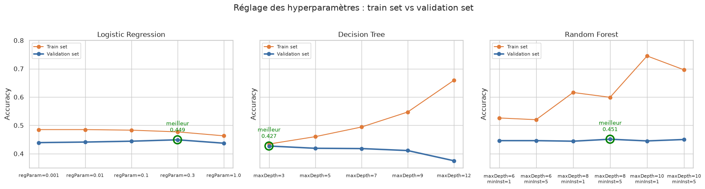
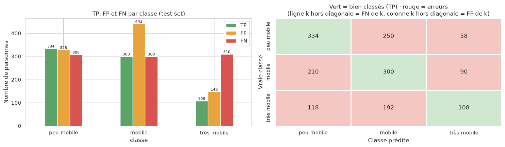

# Prédiction du niveau de mobilité quotidienne des Dakarois avec PySpark

Projet du module **Big Data** — École Mohammadia d'Ingénieurs (Université Mohammed V de Rabat), filière Modélisation et Informatique Scientifique.

**Réalisé par :** Hayat WALDI et Khaoula ELHONNYA — **Encadré par :** Pr. BENHLIMA

---

## Problématique

> À partir du profil d'une personne et de son ménage, peut-on prédire combien de déplacements elle fait dans une journée ?

C'est un problème de **classification multiclasse** : chaque personne est rangée dans un niveau de mobilité.

| Classe | Déplacements par jour | Part des personnes |
|---|---|---|
| 0 – Peu mobile | 1 à 2 | 36,1 % |
| 1 – Mobile | 3 à 4 | 37,0 % |
| 2 – Très mobile | 5 et plus | 26,9 % |

## Données

Enquête ménages-déplacements de la région de Dakar (départements de Dakar, Pikine, Guédiawaye et Rufisque) : **45 605 déplacements**, **11 457 personnes** de 11 ans et plus, **3 127 ménages**, 33 variables.

Le fichier de données n'est pas inclus dans ce dépôt (voir [`data/README.md`](data/README.md)).

## Démarche

1. **Analyse exploratoire (pandas)** : qualité des données, anomalies (coût codé 99 999, heures après minuit, codes de zone spéciaux), distributions, rythme de la journée, analyse bivariée, corrélations.
2. **Préparation avec Apache Spark** :
   - ingestion avec un schéma explicite et `cache()` ;
   - nettoyage, avec visualisation avant / après ;
   - **agrégation** des déplacements en personnes (`groupBy`, `max_by`) ;
   - variables de ménage par **window functions** (taille, enfants, seniors, âge moyen, part de femmes, sexe du chef) ;
   - statistiques pondérées par la population en **Spark SQL**.
3. **Modélisation avec Spark MLlib** :
   - découpage **train / validation / test (70 / 15 / 15 %) par ménage** (hash du numéro de ménage) pour éviter le data leakage ;
   - `Pipeline` : `StringIndexer`, `OneHotEncoder`, `VectorAssembler`, `StandardScaler` ;
   - Logistic Regression, Decision Tree et Random Forest, dans deux scénarios de features (profil seul / profil + activité) ;
   - choix du modèle et des hyperparamètres sur le validation set, évaluation unique sur le test set.

## Résultats

| Modèle | Accuracy validation | Accuracy test | F1 pondéré (test) |
|---|---|---|---|
| Baseline (classe majoritaire) | 0,378 | 0,361 | 0,192 |
| Decision Tree (`maxDepth=3`) | 0,427 | – | – |
| Logistic Regression (`regParam=0.3`) | 0,449 | – | – |
| **Random Forest (`maxDepth=8`, `minInstancesPerNode=5`)** | **0,451** | **0,447** | **0,440** |

- Le modèle retenu gagne **+8,6 points** d'accuracy sur la baseline, avec un score de test proche de celui de validation.
- Les plus mobiles sont les **jeunes**, les **élèves**, les **hommes** et les habitants de la **banlieue** ; 88 % des personnes font un nombre pair de déplacements (allers-retours).
- La classe « très mobile » est la plus difficile à reconnaître (recall 0,26). Les features les plus importantes sont la zone de résidence, l'âge et l'activité.
- Le profil sociodémographique n'explique qu'une partie de la mobilité : il manque des variables comme le revenu, la possession d'un véhicule ou les distances.





## Contenu du dépôt

```
.
├── notebooks/
│   ├── Projet_BigData_Mobilite_Dakar.ipynb   # notebook exécuté et commenté
│   └── Projet_BigData_Mobilite_Dakar.html    # version HTML, lisible sans Jupyter
├── rapport/
│   ├── Rapport_Mobilite_Dakar.pdf            # rapport du projet
│   └── latex/                                # sources LaTeX (compiler avec XeLaTeX)
├── data/
│   └── README.md                             # où placer le fichier de données
├── requirements.txt
└── README.md
```

## Exécuter le notebook

Prérequis : Python 3, **Java 17** et les bibliothèques de `requirements.txt`.

```bash
pip install -r requirements.txt
```

1. Placer le fichier `donnees_deplacement_PSpark 2026.xlsx` sur votre machine.
2. Dans le notebook, adapter le chemin du fichier (`file = ...`, cellule 1.1) et, sous Windows, le chemin de Java (`JAVA_HOME`, partie 2.1).
3. Exécuter les cellules dans l'ordre. L'entraînement de tous les modèles prend environ 15 à 20 minutes en mode local.

**Sous Windows :** Spark utilise les bibliothèques Hadoop pour accéder aux fichiers ; placer `winutils.exe` et `hadoop.dll` dans `C:\hadoop\bin` (variable `HADOOP_HOME`). En cas d'erreur `BindException` au démarrage de Spark, ajouter `.config("spark.driver.bindAddress", "127.0.0.1")` à la création de la session.

## Technologies

Python · Apache Spark 3.5 (PySpark, Spark SQL, MLlib) · pandas · Matplotlib · Seaborn · LaTeX
